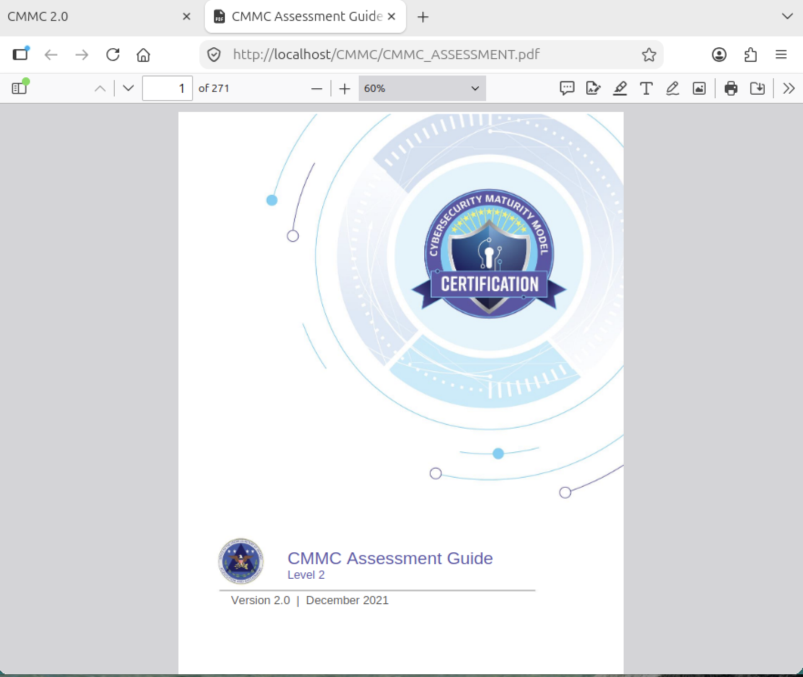
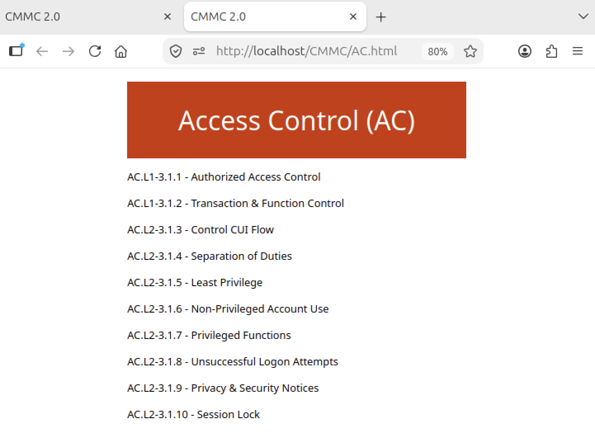
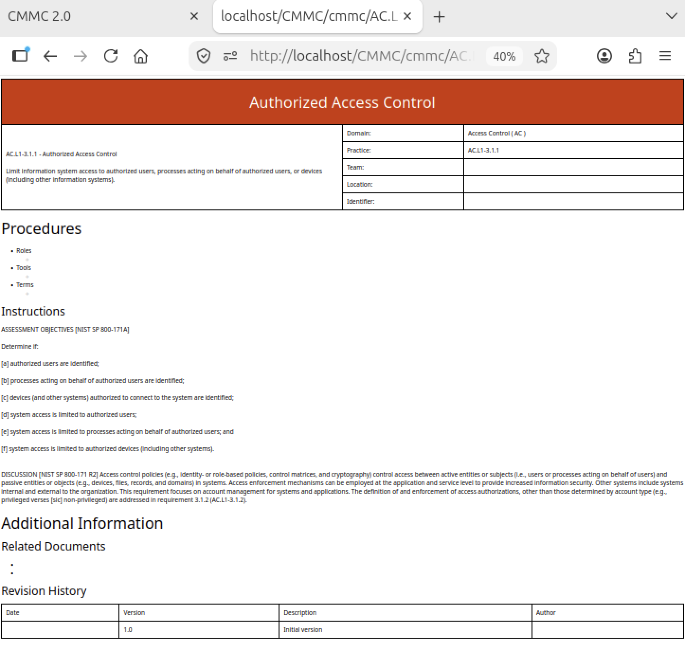

## CMMC

CMMC provided guidance for compliance with 32 CFR Part 2002, DFARS 252.204-7012, and DoDI 5200.48 in the implementation of National Institute of Standards and Technology (NIST) SP 800-171. The US Department of War suspended CMMC II in 2026.

 
Automated generation of Cybersecurity Maturity Model Certification (CMMC 2.0) compliance templates improves accuracy and completeness.  This easy-to-read user interface enables quick access to each template.

Example of accessing the Access Control assessment

