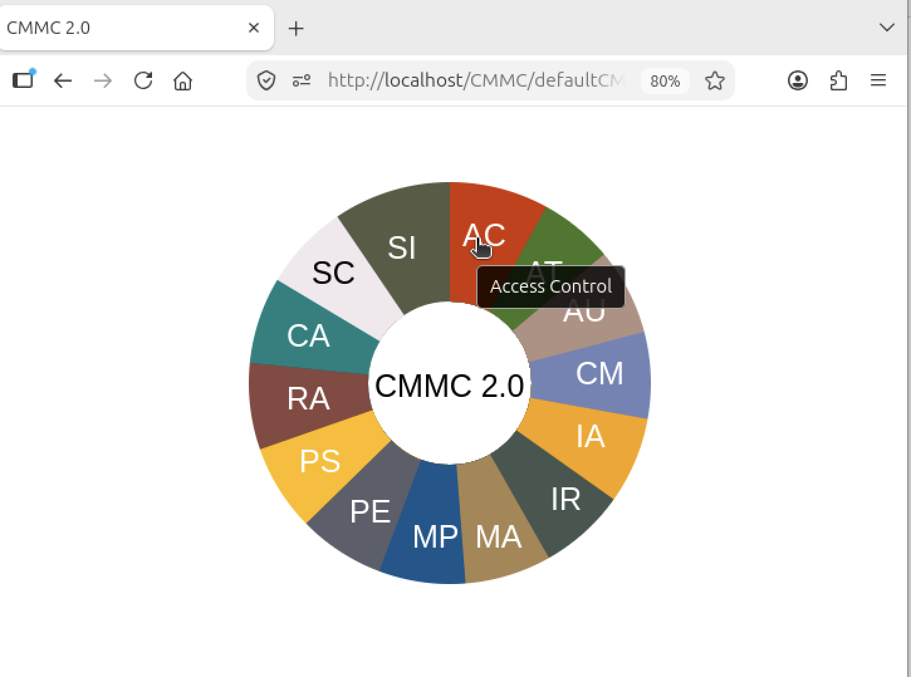
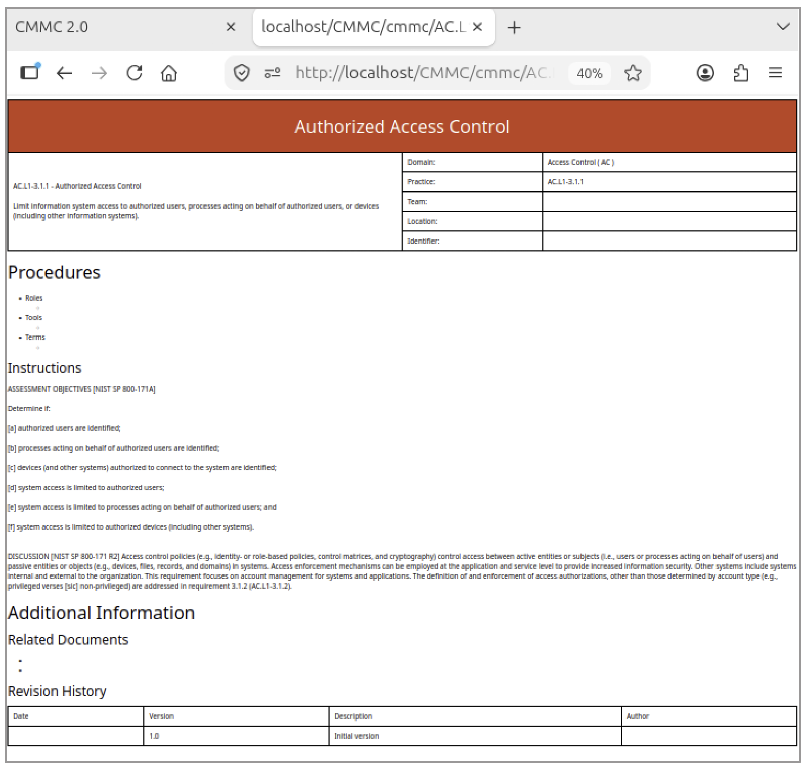

## Cybersecurity Maturity Model Certification (CMMC)

Phase I of CMMC implementation began in November 2025.  Phase II was scheduled to begin in November 2026, but it has been suspended while a comprehensive review is undertaken [1].  

The CMMC Assessment Guide Level 2 was issued in September 2024 and government contractors such as Crane Aerospace began compliance projects.  As a technical writer I was tasked with developing templates for each requirement.  When I read the guide, I realized that the content had been standardized with each section organized first by domain and then by individual security requirements.  Each requirement description contained the same elements.  This made it possible for me to write a python script to automate output templates in HTML format.  Not only did this save time, it improved accuracy and completeness.  About the same time, I was working on a project called "Gearing up for Compliance" and the graphics included interactive wheels.  That inspired this easy-to-read user interface that provides quick access to each template.

Example of accessing the Access Control assessment

*The US Department of War suspended CMMC II in 2026.*

---

References

[1] [About CMMC](https://dodcio.defense.gov/cmmc/About/)
