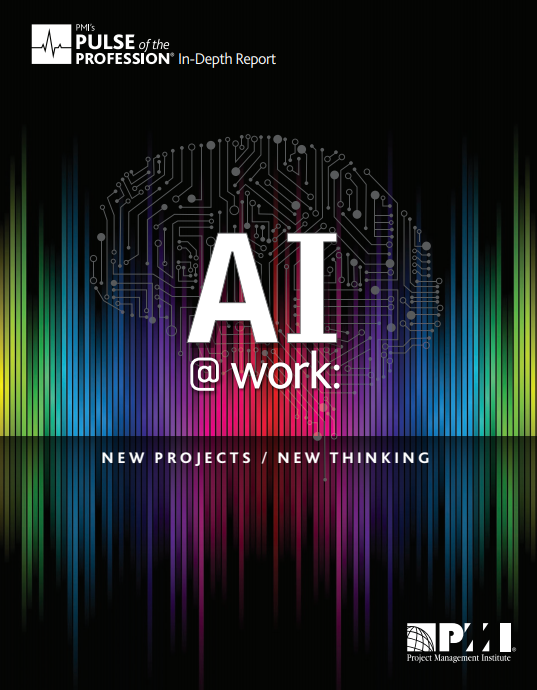

### PMI Thought leadership >> Pulse of the Profession

AI @ Work: New Projects, New Thinking (2019)

PMI research reveals that project managers are already using AI technologies, such as robotic process automation and anti-bias solutions, to boost project productivity and quality.  

74% of respondents say they are confident their current skill set enables them to work with AI. Innovators with awareness and experience using knowledge-based systems, decision management, speech recognition, and expert systems have the upper hand.  

This 4-PDU class teaches project managers how to become Innovators. You will learn new management strategies through lecture and hands-on lab experience in the AI Lab. Project managers experience robotic process automation, innovative robot speech techniques, smart, goal-oriented decision systems, and automated project reporting. It exposes project managers to anti-bias solutions.  

Project managers will take away an AI Risk Register listing known risks specific to various types of AI. They will participate in evaluating and expanding PMBOK guidance for managing AI.
