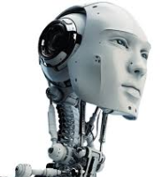

### What is AI?

Artificial Intelligence senses its environment and reasons about how to achieve specific goals

Artificial Intelligence software is essentially advanced statistics used to predict future outcomes based on statistical analysis of prior outcomes

[If you want to learn more, read this Wikipedia article called, "Artificial Intelligence"](https://en.wikipedia.org/wiki/Artificial_intelligence)

