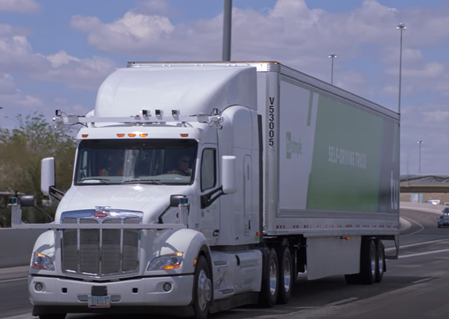
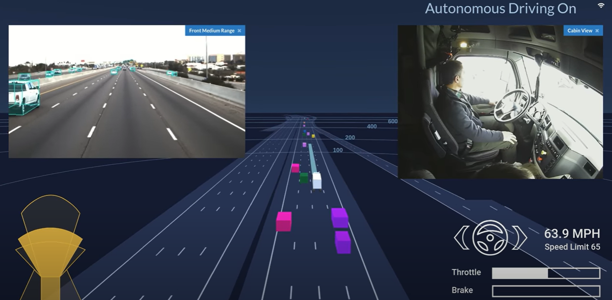

### [Will AI take my job?](https://www.youtube.com/watch?v=f2aocKWrPG8)

Watch first 5 minutes of the video and review the comments

 

<article class="w3-row">

   

      
    
      
    Due to difficult working conditions, there is a shortage of long-haul truckers.
     To meet demand, TuSimple is developing AI so that long-haul, heavy-duty 
     trucks operate autonomously on both highways and surface streets
      
   

      

   

      
    
      AI sees other cars on the freeway in bounding boxes.  
     A human rides in the driver's seat during test drives
      
 

      

