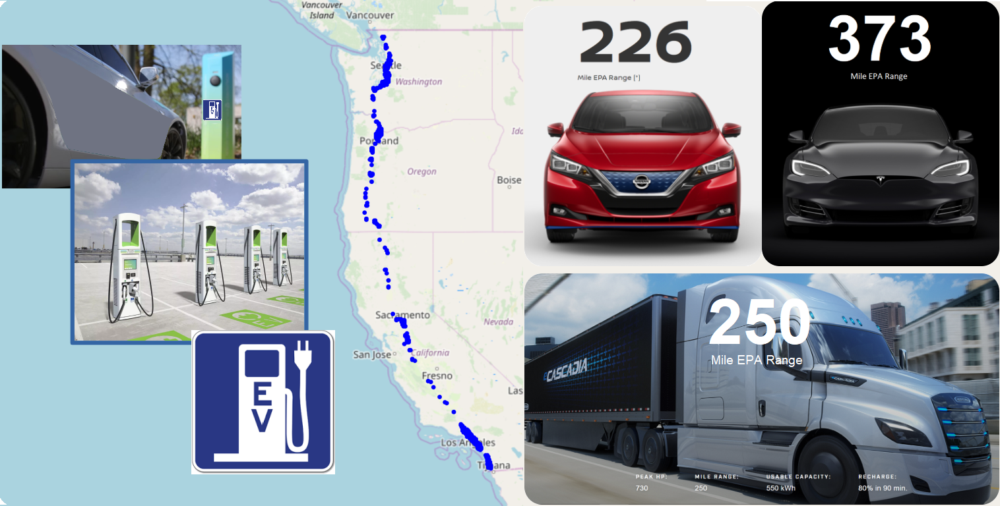

### DRIVE I-5 EXPERIMENT

Suppose you are a project manager responsible for delivery of goods along the I-5 highway in the Western USA.

All goods are delivered by autonomous delivery vehicles. For this experiment your team includes an autonomous vehicle called, Bumblebee AV.

Your customers are native Spanish speakers living in Baja California and native Chinese speakers who just moved to Vancouver, Canada.

During the original course, attendees participate in a live lab demonstration.  A miniature autonomous vehicle computed recharging stops while planning to drive to various destinations on I5.

### What does the Drive I-5 experiment teach us about managing AI?

After a group discussion, it was decided that AI supports real-world scenarios being considered by automobile manufacturers, cities, and power companies. AI does repetitive tasks. AI has onboard contingency plans. AI is self-aware. AI uses the internet and existing payment systems such as VISA debit cards.

