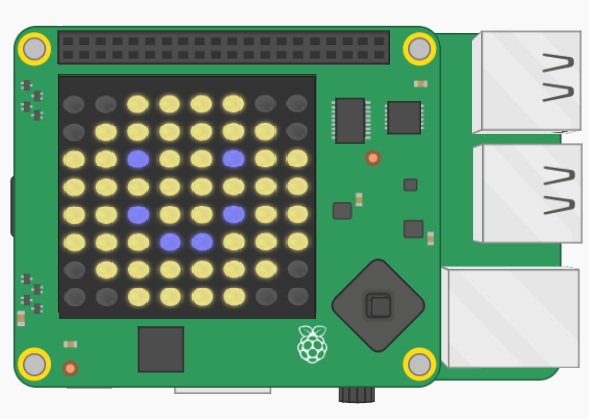
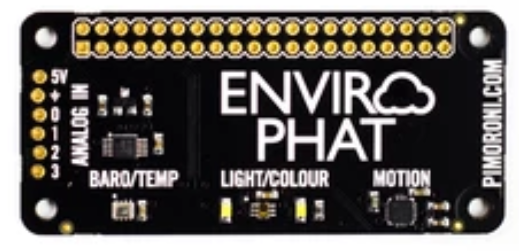
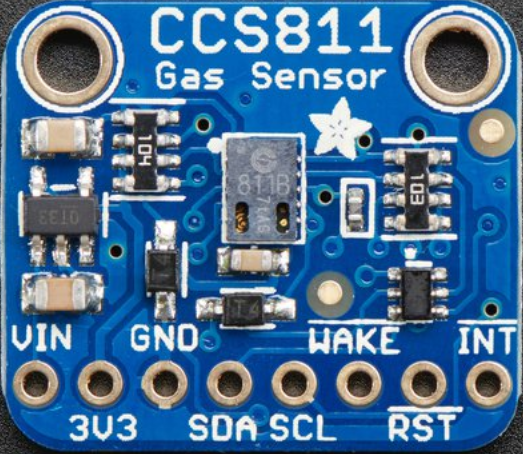
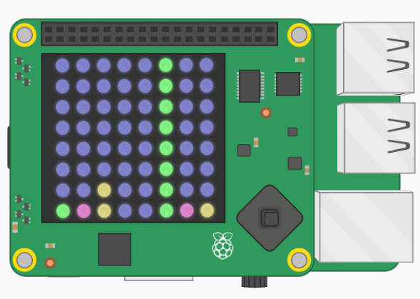
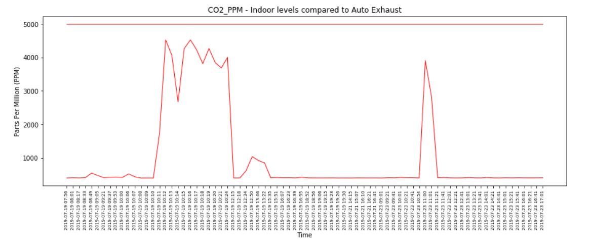
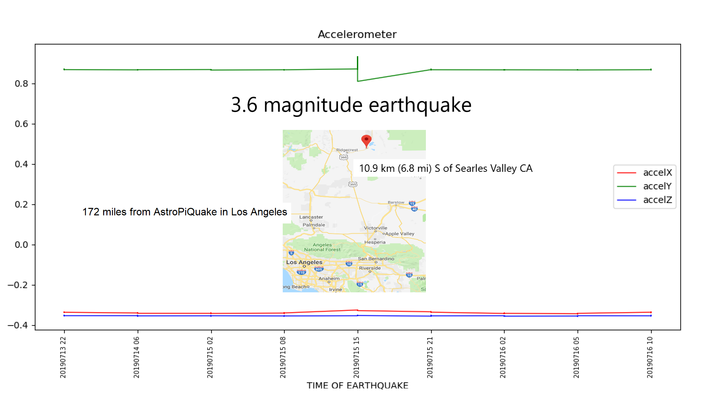

### What is AI doing during the Drive I-5 experiment?

---

#### AstroPiQuake Temperature Smiley

  
Click on the device, then move the temperature slider to see Smiley's face change color.

---

#### [Enviro Environment Sensor](https://github.com/NelsonPython/EnviroPhat)

---

#### Air MacClean CO2 Sensor
  
Air MacClean detects CO2 and TVOC.  
[Build your own air quality sensor](https://github.com/NelsonPython/CO2TVOC)

---

#### AstroPiQuake Earthquake Detector
  
* Click on the device
* Grab the emulator with your mouse
* Shake it to simulate an earthquake
* Watch the accelerometer readings

---

Enviro senses temperature, pressure, light, local color, accelerometer readings, and magnetometer data.  
[Build your own environment sensor](https://github.com/NelsonPython/EnviroPhat)

---

[What does this chart show?](https://www.kaggle.com/nelsondata/los-angeles-air-quality)  

---

#### Detect an earthquake
  
How do accelerometer readings help detect an earthquake?  

[Get instructions for building your own earthquake detector](https://github.com/NelsonPython/AstroPiQuake)

---

#### Why use more than one sensor?

---

What does this chart show?  

