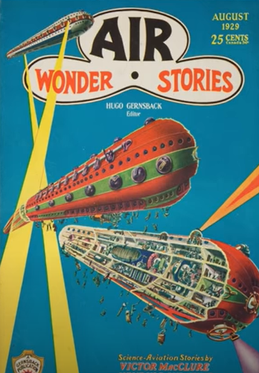
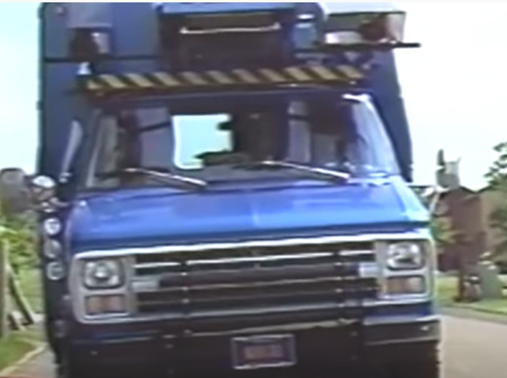
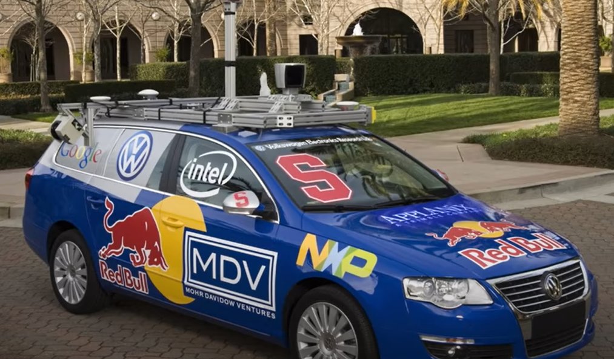

### [Watch a video about the History of Autonomous Vehicles](https://www.youtube.com/watch?v=P1tfOeChenQ)

---

  
First time an AV was described in literature  
1929 Air Wonder Stories

---

  
First AV experiments  
1980 Carnegie Melon NavLab AV

---

  
**Stanford-Google car**  
2010 – Google's fleet of AVs logged 140,000 miles  
2012 - Google's fleet logged 250,000 miles without accident
