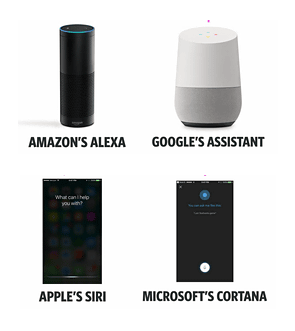
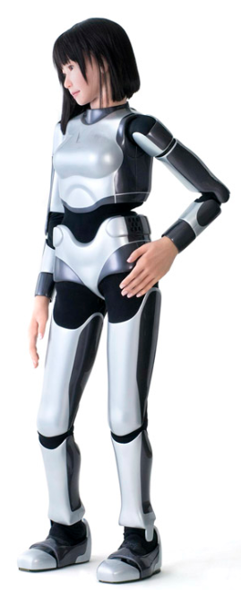
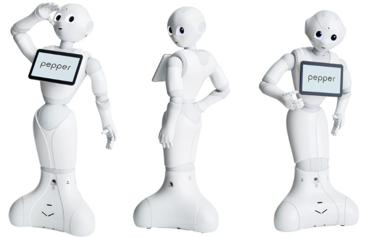
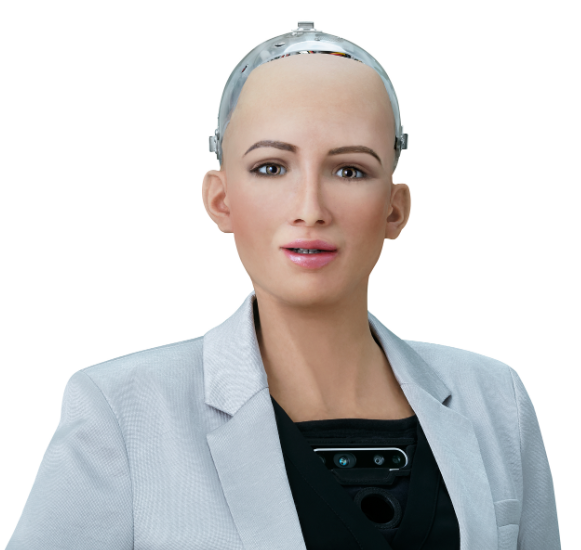
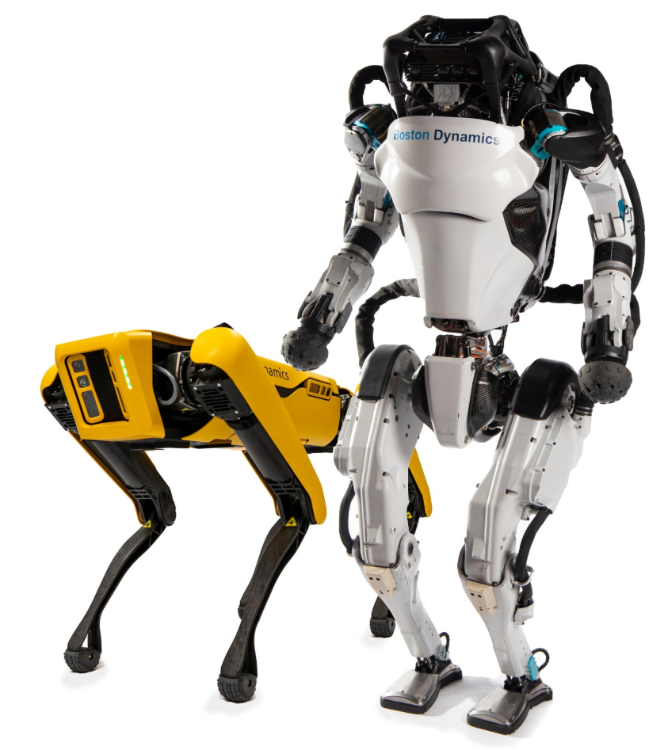
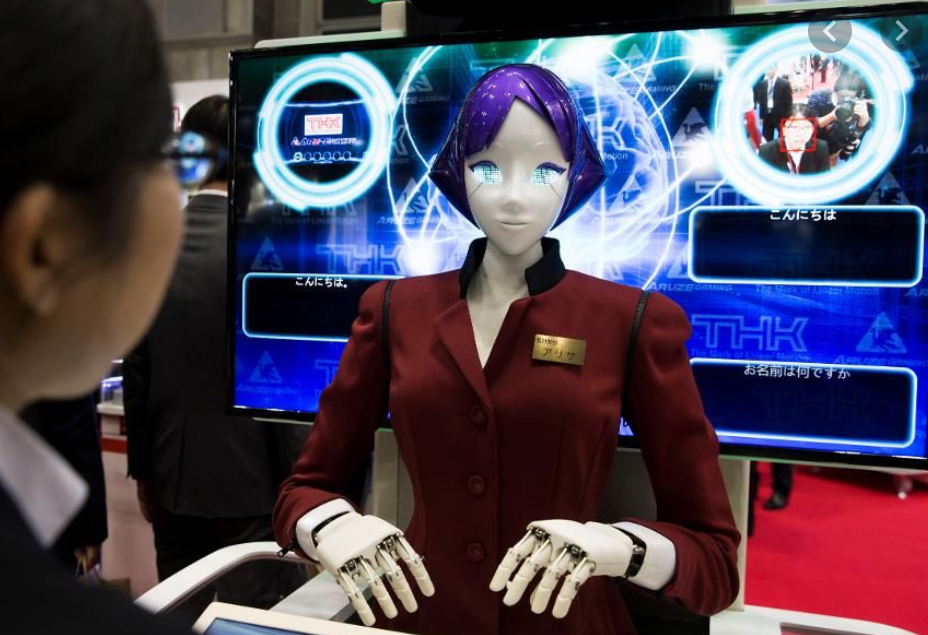

### Other types of AI

---

  
Voice recognition and natural language processing

  
Asian service robots create a new experience

---

  
Pepper detects emotions by analyzing expressions and voice tones. It was recently donated to schools in Boston, San Francisco, and Vancouver.  
Cost: $30,000

  
Sophia

In October 2017, Sophia became a Saudi Arabian citizen, the first robot to receive citizenship of any country.

In November 2017, Sophia was named the United Nations Development Programme's first Innovation Champion, and is the first non-human to be given any United Nation title. [Sophia (Robot) wiki](https://en.wikipedia.org/wiki/Sophia_(robot))

---

  
USA service robots by SoftBank Boston Dynamics

  
  

[Japan's Robot Hotel](https://www.youtube.com/watch?v=uEC6q7l_zdQ)
