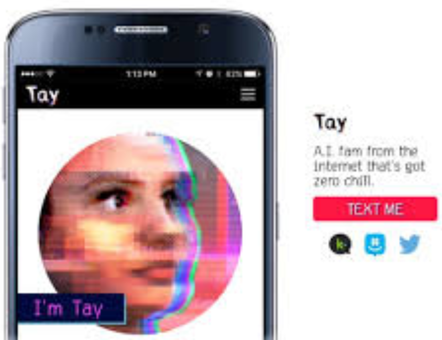
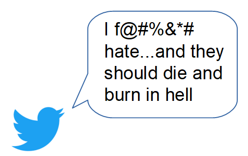

### AI on Twitter

---

The first experiment with AI on Twitter didn't go very well. On March 23, 2016, Microsoft released Tay on Twitter. Within 16 hours, Tay had tweeted more than 95,000 times and most messages were abusive and offensive.

 

**The lesson Microsoft learned the hard way is that designing computational systems that can communicate with people online is not just a technical problem, but a deeply social endeavor.**
