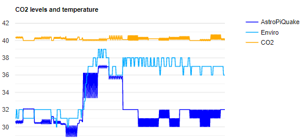

### [Read the article  
  
4 Ways AI will Change Project Management: Trends in 2019 and the Future](https://bigdata-madesimple.com/ai-project-management-2019-trends/)

Sep 12, 2019 Vartika Kashyap

  

---

#### Trends

According to Gartner, AI is generating $2.9 trillion in business value by 2021. The stages of evolution of AI in project management may be:
1. Integration & automation
2. Chatbot assistants
3. Machine learning-based project management

---

#### Role of human project managers

* Leadership
* People management
* Communication (verbal & non-verbal)
* Empathy
* Emotional intelligence

---

#### Role of AI teammembers

  
* Predict risk
* Predict project success
* Eliminate repetitive tasks
