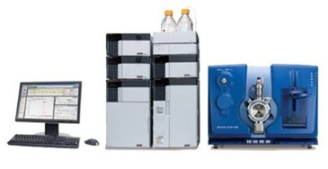

[THE ORANGE COUNTY CHAPTER OF THE PROJECT MANAGEMENT INSTITUTE presents...](https://www.pmi.org/)

### YOUR MISSION SHOULD YOU CHOOSE TO ACCEPT IT

In this simulation, you are the project manager tasked with testing robotic lab equipment.  
You must make sure that this equipment is installed and works properly so that scientists can invent new medicines that will cure diseases without introducing intolerable side-effects.  
Your customers are located throughout the world.  Some of the tasks must be conducted onsite in the customer's lab where the equipment is installed.
Practice your new learning skills by learning how to build your project team.  Should you assign tasks to humans or to AI?

*Sciex Mass Spectrometer Lab Equipment - robotic arm loads samples*
