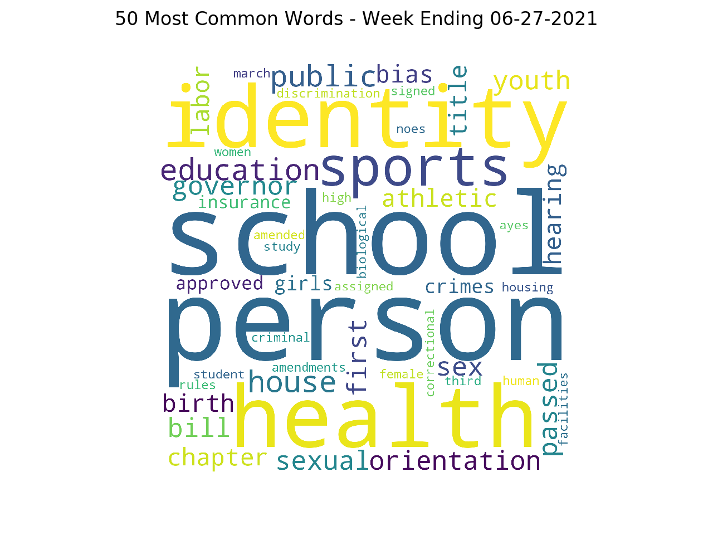
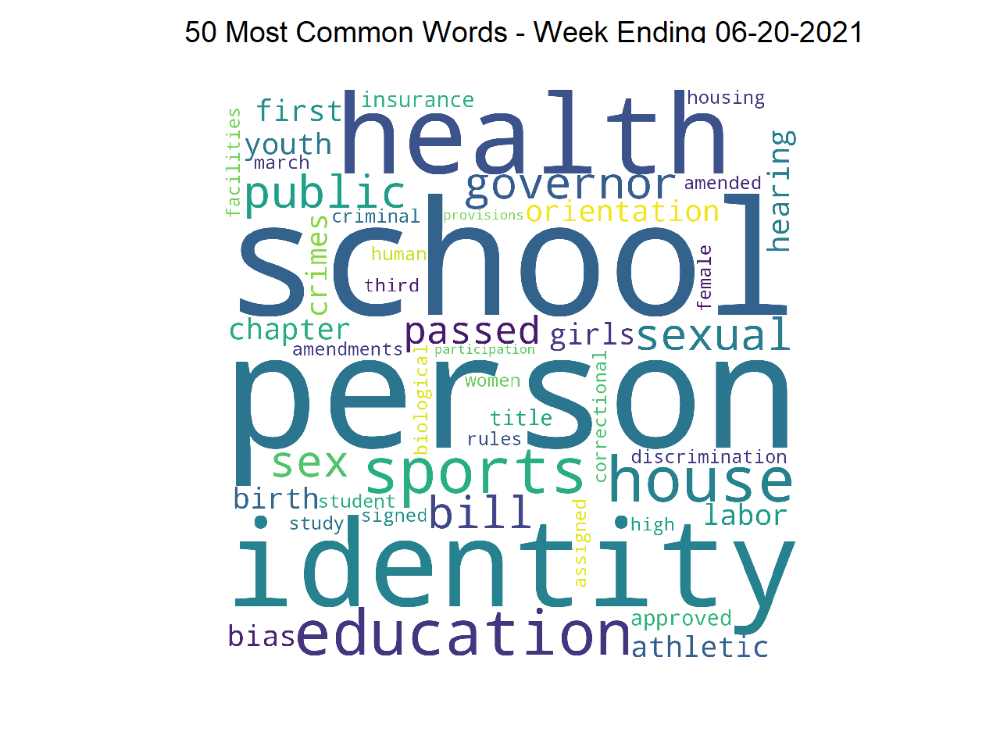

[THE ORANGE COUNTY CHAPTER OF THE PROJECT MANAGEMENT INSTITUTE presents...](https://www.pmi.org/)

### WHICH TASKS CAN AI COMPLETE?

In 2021, AI is good at predicting outcomes given accurate, non-biased, historical data. AI can make rudimentary language translations. Robots can manuever in traffic. Can AI lead a project?  

#### AI and Consciousness

Can AI use the governance model to figure out how to manage this project? In other words, can AI replace you as the project manager?

First, and most importantly, the primary goal of your project is to safeguard human life. As human beings, we are hard-wired for our survival.

AI is agnostic about survival. It computes when the power is on. It stores data but it does not compute when the power is off.

How would AI learn that human survival is important?  
In order to "think", AI needs lots of data. Social media has lots of data that express human values. Could AI analyze millions of social media posts and reflect our collective values regarding human life?

Here's a simple example showing how AI can read and analyze data using natural language processing.  
In this example, AI is reading posts published at LegiScan and creating word clouds showing popular themes.  
LegiScan is a website that publishes texts of bills introduced in federal and state legislatures.  
From February through June 2021, AI indicates that state legislatures have focused on these themes: person, school, identity, health, sports, and education. Here are some of the word clouds. Words in larger fonts are used more frequently.

  

Is it true? Did legislators focus on bills related to the health and education of people with identities playing sports at school?  
Yes, legislators across the USA focused on bills related to the issues surrounding the health and education of girls if transgender girls were allowed to play sports at school.  
I verified that, as of June 2021, 25 states propose banning transgender girls from girl's sports.  
Putting aside any personal bias or opinion about this controversial topic, we see that AI is reflecting the values of elected officials in the USA.

What would AI reflect from analyzing social media? Take a look at [Microsoft's Twitterbot experiment](https://github.com/NelsonPython/publications/blob/main/pmi_course_AI_team_member/html/08_twitter.md).  
What would AI reflect from analyzing the Code for Federal Regulations or reputable newsfeeds or some other source of data?

In my opinion, discussions about AI and consciousness are intriguing and important.  
At this time, I am not aware of any AI products that could reason about and develop a plan to test whether lab equipment works properly so that scientists can invent better medicine. But there are many AI tools that can evaluate data and provide valuable insights to support this goal.

