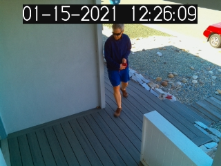
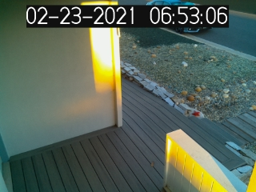
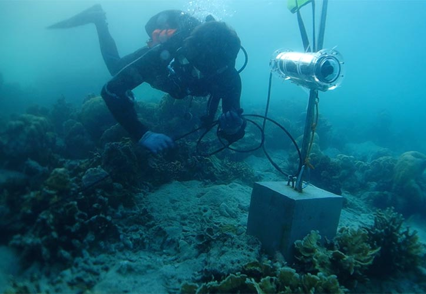

[THE ORANGE COUNTY CHAPTER OF THE PROJECT MANAGEMENT INSTITUTE presents...](https://www.pmi.org/)

### Smart Cameras

  

The first photo was taken on January 15 and the security camera reported that someone was on the porch.  
The second photo was taken on February 23 and the security camera reported that someone was on the porch.  
Why?

Accenture teamed up with technology and industry partners to use smart cameras to aid in restoring the reefs.  

[Raise the reef: AI helps power coral reef restoration](https://www.accenture.com/us-en/case-studies/applied-intelligence/ai-helps-power-coral-reef-restoration)

