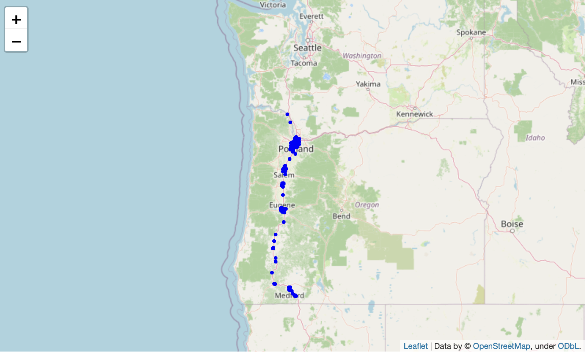

## Map EV Charging Stations on Highway I-5

Suppose you own an electric vehicle (EV). You want to drive one of the most important trade routes in the western USA, the I-5. I-5 is 1,381 miles of highway from southern California to northern Washington. Truckers deliver goods from Mexico to Canada with stops at distribution centers and ports in Los Angeles, San Francisco, Portland, Seattle, and other cities. Families drive to vacation spots in Yosemite National Forest and other popular destinations. Where will you stop and charge your EV? How many EV charging stations are there along I-5? This notebook starts exploring data about EV charging stations published by the Alternative Fuels Data Center of the USA Department of Energy.

First, is this data current? According to the USA Department of Energy, data from 2049 stations was confirmed in 2019. Data from 99 stations was confirmed between March and November 2018.

Next, what does the data tell us about EV charging stations along I5?

606 stations offer FREE refueling

1938 stations offer the J1772 EV connector type. 187 stations offer TESLA connector types and 25 stations have only CHADEMO.

EV Networks include: Blink Network, ChargePoint Network, EV Connect, eVgo Network, GE, Greenlots, OpConnect, SemaCharge Network, Tesla Destination, Tesla,Electrify America, WattStation, and Webasto

Unfortunately, 2134 stations are missing a list of cards that they accept so drivers cannot verifiy that their card will be accepted

The following code was used to compute these statistics. Comments are included explaining the logic.

