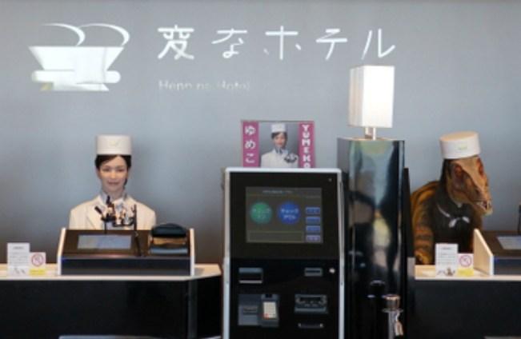

### [Review the article  
  
How AI Is Transforming Project Management](https://mymanagementguide.com/how-ai-is-transforming-project-management/)

---

AI chatbots handle customer service tasks to improve customer experiences

AI offers hotel guests the ability to customize their rooms. Some offer an AI personal assistant in addition to chatbots

Hotel and casino businesses collect data about guests to learn about their behavior. The threshold for slot machines winnings can be set to attract more gamblers

AI monitors inventory and supply chains and provides real-time product tracking. AI can monitor many supply chains at once and is more likely to give accurate results when it reports inventory
