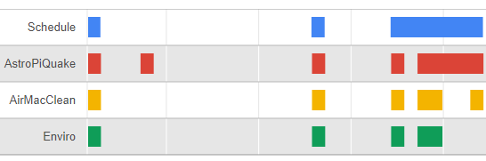
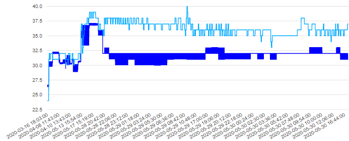
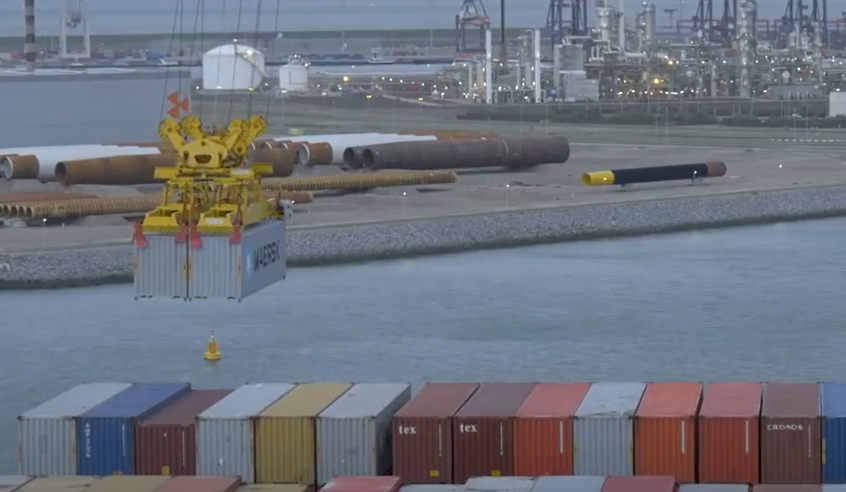
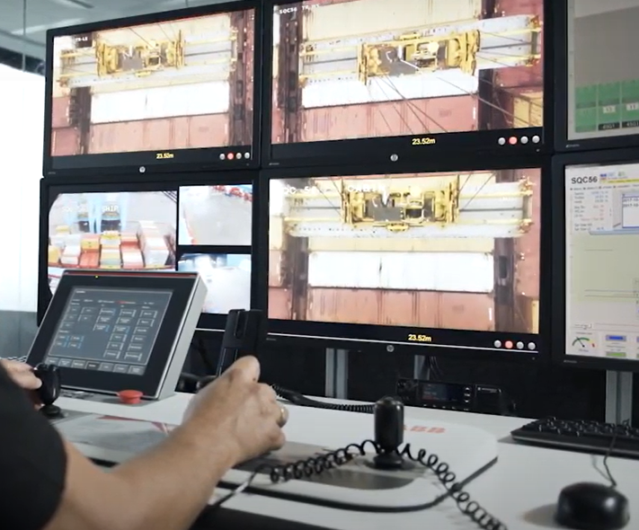

### [Read the article  
  
How AI and IoT Provide Value in Construction](https://www.iotforall.com/ai-iot-construction/)
  

---

*AI is like a smart assistant that can scrutinize this mountain of project data and alert project managers about the critical things that need their attention and also highlight easy levers to pull to improve outcomes*

#### Project schedule optimization 
  
* AI can help fill the shortage of construction workers
* Sensors help prevent idle time by monitoring the location and status of construction equipment 
* AI helps manage cash flow by monitoring the construction materials supply chain

---

Sensors can help manage materials, for example, they help optimize concrete curing times

Sensors provide better situational awareness to reduce waste, emissions, and noise

#### Predictive maintenance
  
* Tracking defects can help forecast project risk
* Monitoring equipment and materials can limit downtime by reducing inspections

---

  
Devices such as the autonomous crane are safer because they can be monitored by crane operators from an office  

