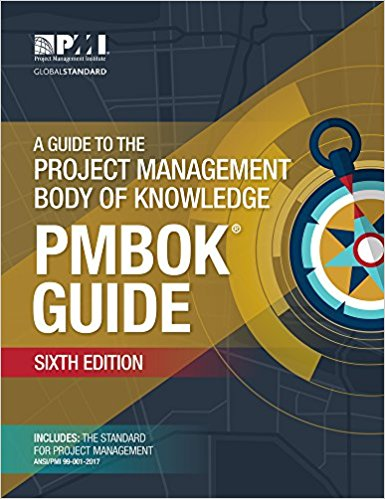

### PMBOK &reg; Project Management Book of Knowledge

  
Best practices in project management:

* Section 4 Project Integration Management
* Section 5 Scope Management
* Section 6 Schedule Management
* Section 7 Cost Management
* Section 8 Quality Management
* Section 9 Project Resource Management
* Section 10 Communications Management
* Section 11 Risk Management
* Section 12 Procurement Management
* Section 13 Stakeholder Management
