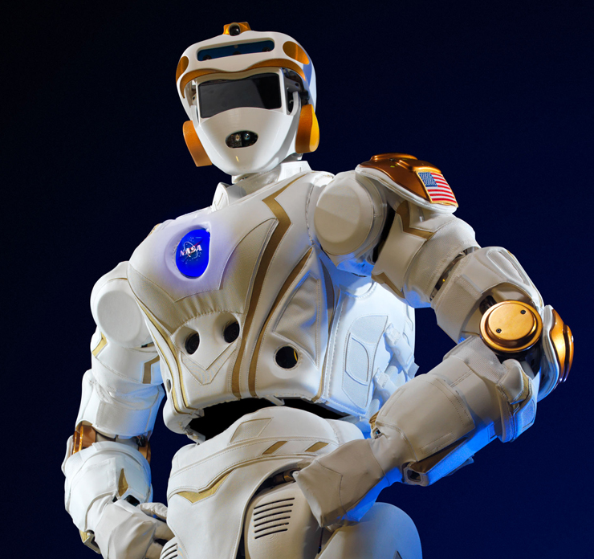

### RECAP: Can AI be a member of your project team?

---

There are many types of AI from simple environment sensors to autonomous vehicles and to humanoid robots

The USA DoD and others are considering ethical treatment of AI

As Project Managers, we are already managing many types of AI. We can add guidance to PMBOK to share our best practices with other project managers

Humans and AI are boldly going to infinity and beyond...  

Learn more by reading *The Age of Living Machines: How Biology Will Build the Next Technology Revolution*  
by Susan Hockfield, MIT

---

[5 Biggest Project Management Trends](https://blog.capterra.com/5-biggest-project-management-trends-shaping-2017/)

[How Businesses are using Machine Learning and AI](https://blog.capterra.com/how-businesses-are-using-machine-learning-and-ai-in-2017/)

[40 Amazing Artificial Intelligence Facts Worth Tweeting About](https://blog.capterra.com/40-amazing-artificial-intelligence-facts-worth-tweeting-about/)

[The Potential Legal Issues of AI (And Why You Should Care)](https://blog.capterra.com/ai-legal-issues/)
