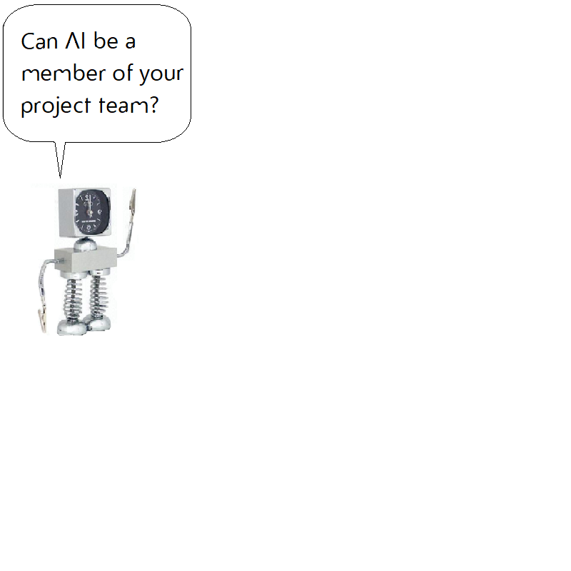

[THE ORANGE COUNTY CHAPTER OF THE PROJECT MANAGEMENT INSTITUTE presents...](https://www.pmi.org/)

*Note:  Under Construction - expect broken links*

This 4-PDU class taught project managers how to become innovators. Through engaging lectures and a hands-on experience in the AI Lab, participants discovered cutting-edge management strategies. They gained direct experience with robotic process automation, innovative robot speech techniques, smart goal-oriented decision systems, automated project reporting, and anti-bias solutions.

Project managers left with a comprehensive AI Risk Register highlighting risks specific to various types of AI. Additionally, they evaluated and helped expand PMBOK guidance for managing AI technologies.

## Can AI be a member of your project team?

| COURSE BEGIN | SCHEDULE END | ACTIVITY |
| :--- | :--- | :--- |
| 8:00 | 8:05 | [Introduce speaker](html/01_speaker_intro.md) |
| 8:05 | 8:15 | Introduce Objectives 1: [Understand skills that AI can offer your project](html/02_what_is_ai.md) 2: [Apply Project Management Book of Knowledge to AI](html/13_pmbok.md) 3: [Gain hands-on experience managing AI in the AI Lab](html/02_pmi_thought_leadership.md) |
| 8:15 | 9:00 | [Review Project Management Book of Knowledge](html/13_pmbok.md) [Consider AI and Quality Management](html/14_pmbok-chapter8.md) [Think about AI Resource Management](html/15_pmbok-chapter9.md) [Experience AI Communications](16_pmbok-chapter10.md) [What new risks does AI introduce to your project?](html/17_pmbok-chapter11.md) [Undertake AI Risk Management](html/18_risk_register.md) |
| 9:00 | 9:10 | 10 minute break |
| 9:10 | 10:00 | [Will AI take my job?](03_a_will_ai_take_my_job.md) [Hands on experience managing AI in the AI Lab](html/03_b_experience_ai_lab.md) [Meet the AI team members from the AI Lab](html/03_c_introduce_ai_lab.md) [Discover self-driving cars on the Las Vegas Strip](html/04_lyft.md) [Consider the future with autonomous vehicles](html/05_future_vehicles.md) [Gain perspective with a brief history of AVs](html/06_av_history.md) |
| 10:00 | 10:10 | 10 minute break |
| 10:10 | 11:00 | [Discover other types of AI](07_other_ai.md) [Learn 4 Ways AI will Change Project Management](html/10_trends.md) [See AI Transforming Project Management](html/11_transform_PM.md) [Learn how AI improves Construction Project Management](html/12_construction.md) [Learn how AI went awry on Twitter](0html/8_twitter.md) [Introduce AI ethics adopted by the USA DoD](09_introduce_DoD.md) |
| 11:00 | 11:10 | 10 minute break |
| 11:10 | 11:45 | [Potential legal issues when managing AI](https://blog.capterra.com/ai-legal-issues/) [Propose best practices for AI project management](html/ai_pmbok.php) [Group review of best practices for AI project management](html/19_review.md) |
| 11:45 | 12:00 | [Recap and student survey](html/20_recap.md) |

## PDU Verification

[July ATS AI and IOT Chat Log (Word)](chatlog/July_ATS_AI_and_IOT_Chat_Log.docx)

