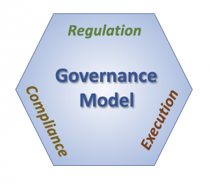

[THE ORANGE COUNTY CHAPTER OF THE PROJECT MANAGEMENT INSTITUTE presents...](https://www.pmi.org/)

### CAN YOU DELEGATE PROJECT MANAGEMENT TO AI?

AI was conceived as a tool to give humans more free time.   
Take a look at [AI job replacement projections](https://www.w3schools.com/ai/ai_job_replacement.asp).

Can we build a system where AI can be the project manager?  
The following concept is inspired by Dr. Nick Stavros, founder of Jackrabbit Consulting and a thought leader for the Object Management Group, a software standards development organization.

Consider how leaders define expectations, grant power, and verify performance.

Consider how leaders define expectations, grant power, and verify performance.

Leaders use [goverance](https://www.omgwiki.org/dido/doku.php?id=dido:public:ra:xapend:xapend.j_gov_model")
In the governance model, defining expectations is called regulation.  Granting power is called execution.  Verifying performance is called compliance.

Good governance has these three components in equal and sometimes opposing aspects.  
Regulation indicates what needs to be done, execution is actually doing it, and compliance is making sure it is done correctly.  
Consider these examples of leadership tasks that AI may be able to undertake.

#### Regulation
In the USA, regulations are rules adopted by a public regulatory agency, usually, based on interpretations of statutes passed by a legislative body.  
USA regulations are written in English, a language that humans can read but it is difficult for AI to interpret.  
The type of AI that strives to interpret language is called natural language processing.  More about that later.

Consider regulations like a collection of contracts.  For example, IRS regulations require you to pay taxes if you earn money.  
Microsoft has undertaken a project to develop AI contracts using the Ethereum blockchain.  
In the future, if you earn Bitcoin then taxes may be paid automatically.  
However, in order to code such a contract, an attorney will need to learn a programming language similar to JavaScript.  
Or a programmer will need to study law.  
And governments will need to trust blockchain.

#### Compliance
Compliance ensures that regulations are met through observation, measurement or testing.  For example, the IRS can audit your tax return.  
Some aspects of compliance are repetitive and can be automated.  
AI might review all the tax returns and analyze which tax returns have the most errors.  It could advise the IRS to audit all tax returns for people who earn more than $200,000/year because these tax returns include the most reporting errors.

#### Execution
Execution is the aspect of governance charged with actually doing the tasks necessary to comply with the rules.  
Robots can and do perform many tasks for us.

Based on this model, where can AI be most helpful?
1. Regulation - AI can legislate new laws to better safeguard human life
2. Compliance - AI can ensure compliance with regulations
3. Execution - AI can complete tasks

[Outline](01_outline.md) &nbsp; [Next](03_governance.md)

---
*1) Stavros, Robert W. and Albrant, Jeremiah; Engineering Governance, SPAWAR, October 9, 2007*  
*2) Adapted from Wikipedia: Governance; accessed 9 July 2007*  
*3) Adapted from Wikipedia: Regulation, accessed 9 July 2007 https://en.wikipedia.org/wiki/Regulation dido/public/ra/xapend/xapend.j_gov_model.txt*
