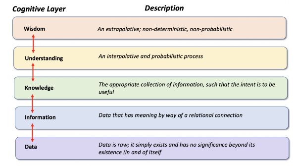

[THE ORANGE COUNTY CHAPTER OF THE PROJECT MANAGEMENT INSTITUTE presents...](https://www.pmi.org/)

### A MODEL FOR ASSIGNING TASKS TO AI

Rather than relying solely on AI or humans suppose we find a way for them to work together?

Here is a model that may help guide your decisions. It is a governance model that was developed by the US Navy SPAWAR. Dr. Stravos explains it [here]
(https://www.omgwiki.org/dido/doku.php?id=dido:public:ra:xapend:xapend.j_gov_model:start). This governance model includes five levels: wisdom, understanding, knowledge, information, and data. Take a look at [an example](https://www.omgwiki.org/dido/doku.php?id=dido:public:ra:1.4_req:00_aboutreq:04_combexmpmdl).

  
*Image used with permission from Dr. Nick Stravos*

The original model had a sixth level called "enlightenment". In order to address AI, I propose we call the sixth level: consciousness.

Look at the diagram starting at the bottom and moving up. Governance allows leaders to use data to create information. From this information leaders gain understanding. When this understanding is combined with experience, wisdom is achieved.

Can AI use this governance process to achieve the consciousness necessary to make decisions about human safety? Human safety is the most important goal of our project because in this simulation your team is testing lab equipment to make sure it works properly so that scientists can invent new medicine.

Let's review each level as it relates to your project. Then, we can decide who does what.

#### Consciousness
Consciousness is our unique awareness of ourselves. The Covid-19 pandemic heightened our awareness and has shown us that we each perceive our responsibility for safeguarding ourselves and others differently. Rather than engaging in a debate about ethics or politics, I propose considering an over-simplification. For purposes of our project, assume that consciousness tells us that robotic lab equipment must function properly in order for scientists to invent new medicines to cure diseases without introducing side-effects that can harm someone.

#### Wisdom
Wisdom comes from experience. In the USA, our collective experience regarding developing medicines and other activities has been codified in the [Federal Code of Regulations (CFR)](https://en.wikipedia.org/wiki/Code_of_Federal_Regulations). The CFR is divided into sections called "Titles". CFR Title 21 addresses safeguarding food and drugs.

#### Understanding
The collection of best practices identified over time by industry experts creates an understanding. CFR Title 21 empowers the Federal Drug Administration (FDA) to regulate Food and Drugs including lab equipment used for inventing medicines. Thus, CFR Title 21 contains the best practices identified by industry experts. You can use them to jumpstart your project.

#### Knowledge
Knowledge defines the criteria under which electronic records and electronic signatures are considered trustworthy and reliable in accordance with a part of Title 21 called, [21 CFR Part 11](https://www.fda.gov/regulatory-information/search-fda-guidance-documents/part-11-electronic-records-electronic-signatures-scope-and-application).

#### Information
Information includes collections of data that provide the proof needed to be certain that scientists followed the rules for their electronic signatures when they signed the results of their experiments. You can imagine the urgency and intense competition as scientists raced to find a Covid-19 vaccine. They may have felt pressure to cut corners but the 21 CFR Part 11 standard operating procedures along with the threat of an FDA compliance audit provide incentives for experiments to be conducted properly.

#### Data
Key data for 21 CFR Part 11 compliance includes the test results showing that the lab equipment performs as expected.

#### What are the possibilities?

Do you think that AI could use the Code of Federal Regulations as a guide to conduct this project?

Which layers of this model do you believe AI could complete successfully?

Hint: [AI Job Replacement Projections](https://www.w3schools.com/ai/ai_job_replacement.asp)

[Outline](01_outline.md) &nbsp; [Next](04_sample.md)
