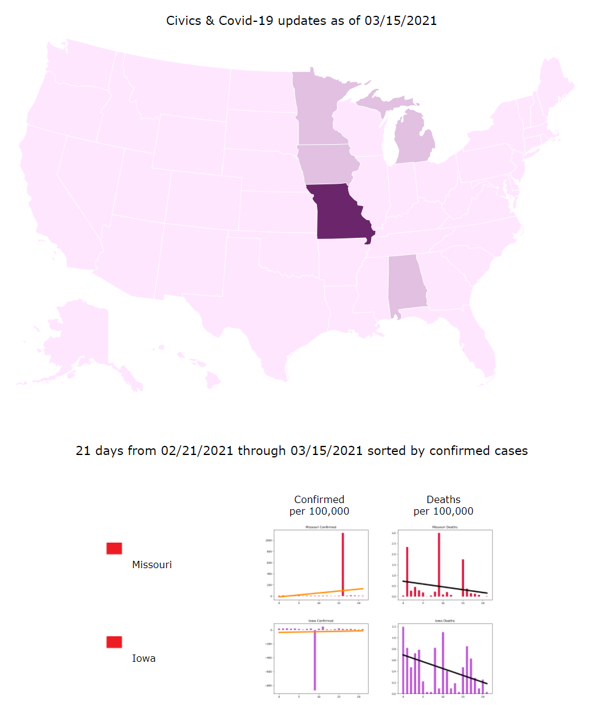
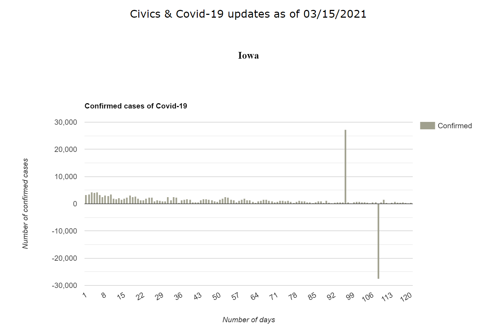
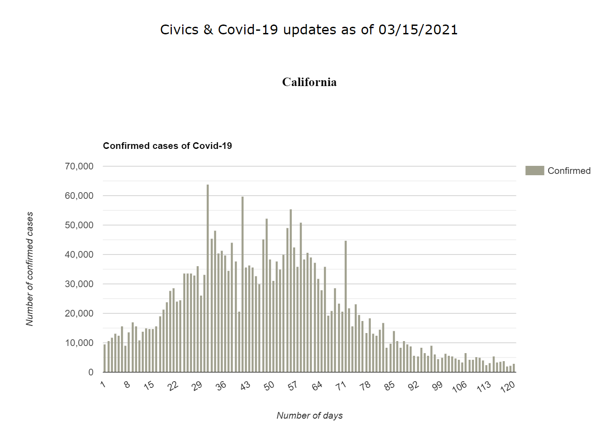
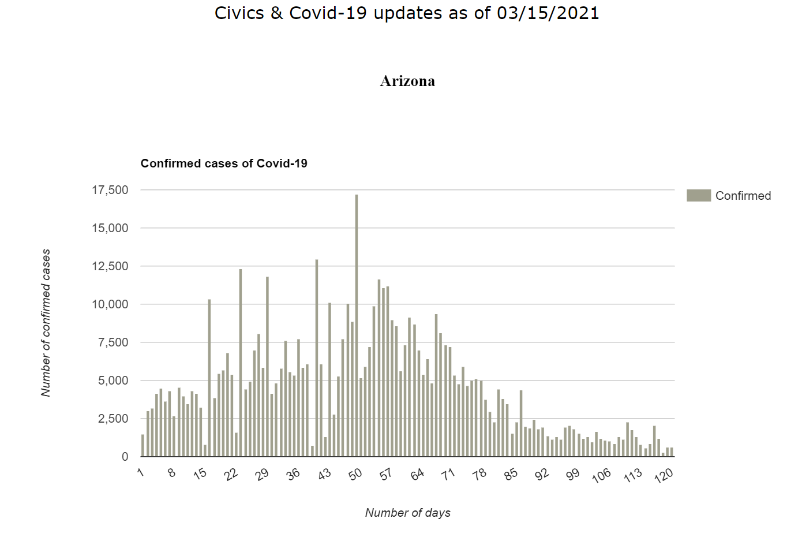
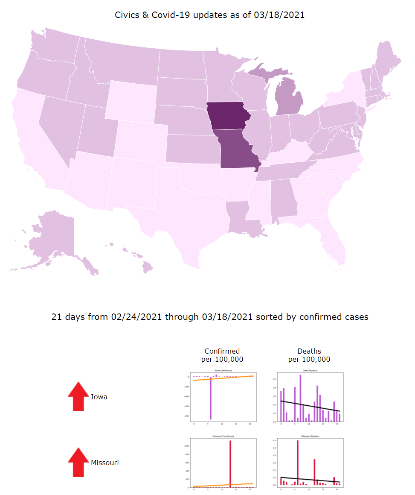
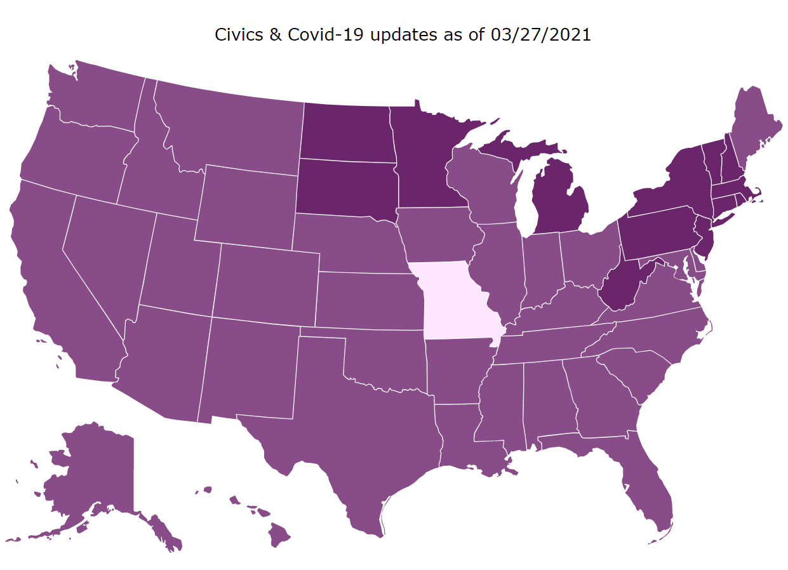
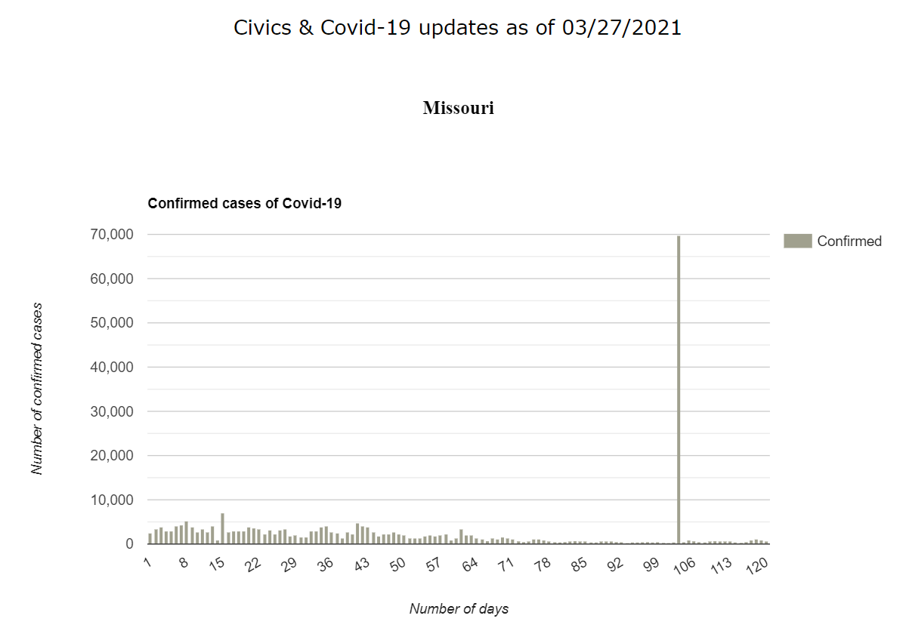

[THE ORANGE COUNTY CHAPTER OF THE PROJECT MANAGEMENT INSTITUTE presents...](https://www.pmi.org/)

### Applying AI to Projects

The objective of this exercise is to discover the types of questions a project manager should ask when evaluating data produced by machine learning or AI.  

The data and examples for this exercise are from a data engineering project that used simple linear regression.  
The Civics & Covid-19 project was undertaken because Covid-19 has been perceived and managed differently across the United States.  
The aim has been to provide data to support research for understanding which political policies best protect the health of USA citizens.

Review the material below then make a list of questions based on what you observe:    
- Do the graphs look like what you expected?
- Do the maps look like what you expected?
- Is the data credible? How do you know?
- Is the data presented in an easy to understand format?
- Take a look at maps and graphs from March 2021. The colors were changed to make it easier to see the data reporting inconsistencies. How would you explain this to your stakeholders?

#### 2020


[Observations about USA political policies in 2020](../DataTutorial-Covid-19/2020/ranked.php?D=2021-06-04)

[Medium article: How You Vote May Affect Your Health](https://cy-nelson.medium.com/how-you-vote-may-affect-your-health-897ffcc96095)

#### 2021
Plots showing inconsistent reporting of data:


[Observations about USA political policy changes in 2021](../DataTutorial-Covid-19/2021/100_ranked.html)

[Medium article: How You Vote Affects Your Health](https://cy-nelson.medium.com/how-you-vote-affects-your-health-d17dbfbcf77a)

---

#### March 15, 2021





#### March 18, 2021


#### March 27, 2021



---

#### How It Works

**Data engineering** is the art of collecting, organizing, and standardizing data for input into AI algorithms

**Ranking the number of cases or deaths**  
Python is a programming language that has a toolkit called, SciPy, short for **Sci**ence **Py**thon.  
SciPy has tools, such as `stats.linregress` for computing linear regression.  
To rank States in the United States for the Civics & Covid-19 project, we used SciPy to compute the least-squares linear regression on raw data.  
The stats.linregress calculation produces a slope and an intercept that can be used to draw a line on a graph.  
We used the slope to rank confirmed cases and deaths. Here's a code snippet:

```python
slope, intercept, r, p, std_err = stats.linregress(days, c)

# days is a numpy array listing values from 1-21

# c is a numpy array with the number of cases or deaths
```

