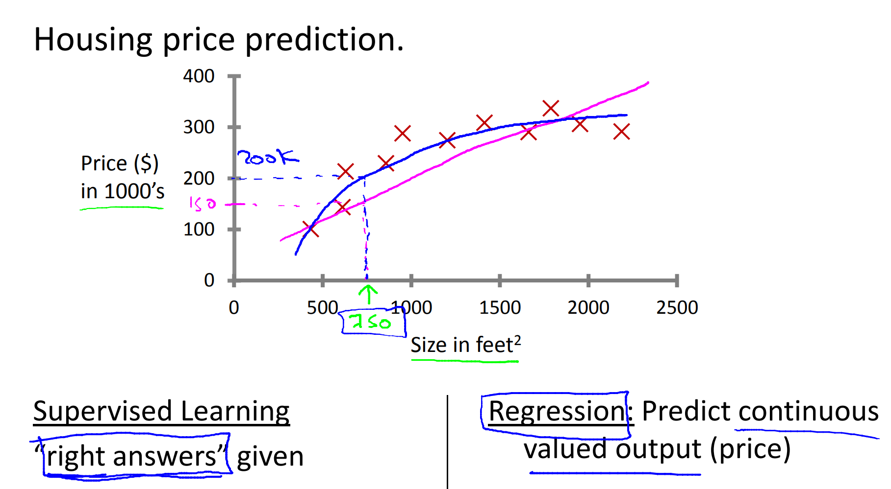
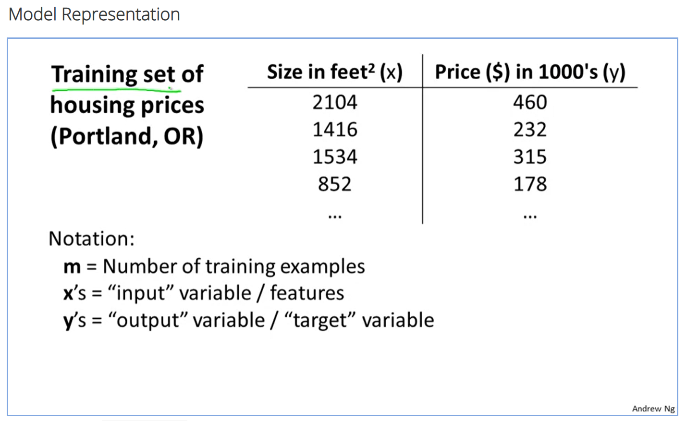
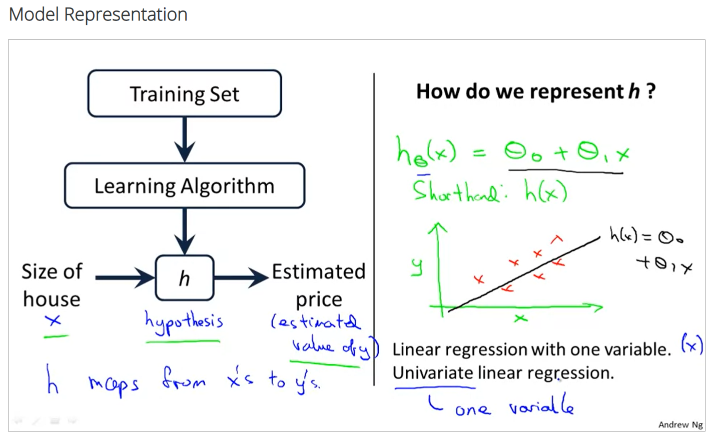
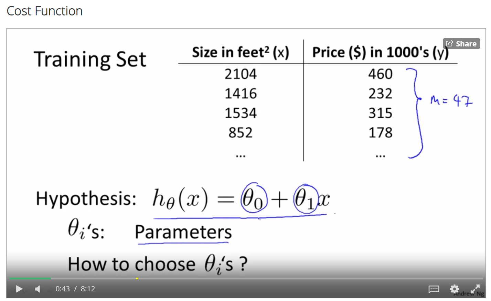
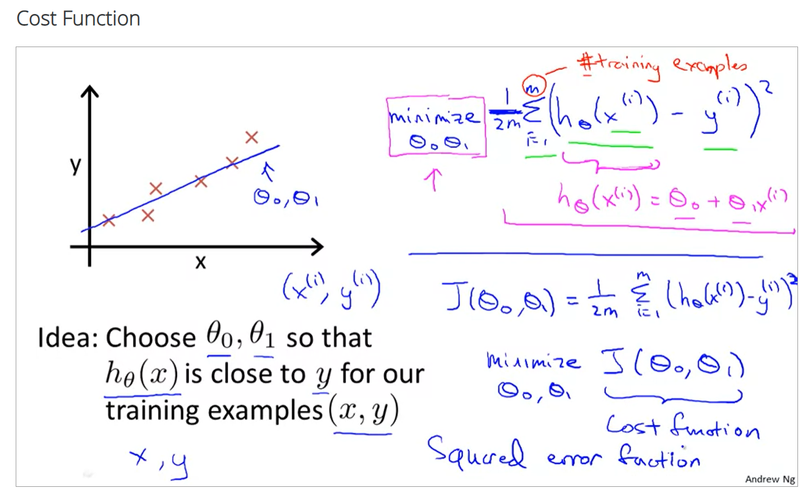
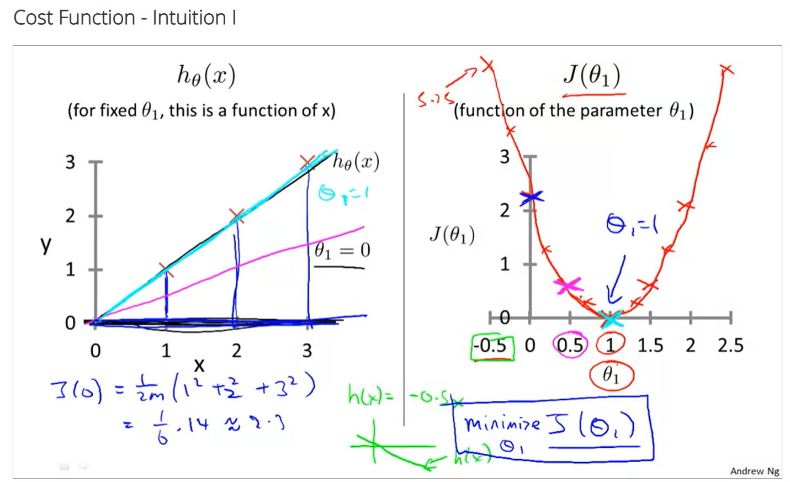
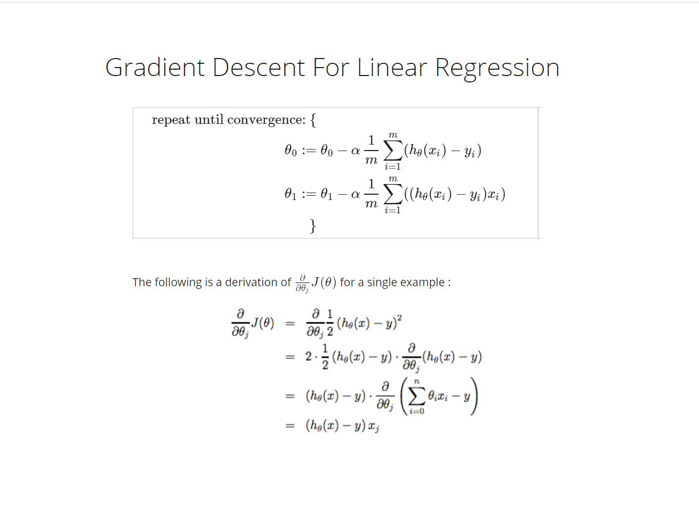

[THE ORANGE COUNTY CHAPTER OF THE PROJECT MANAGEMENT INSTITUTE presents...](https://www.pmi.org/)

### Deep Dive into Linear Regression

Screen captures from the free [Coursera Machine Learning course by Professor Andrew Ng at Stanford University](https://www.coursera.org/learn/machine-learning?utm_source=bg&utm_medium=sem&utm_campaign=37-SAS-Programmer-US&utm_content=37-SAS-Programmer-US&campaignid=415059034&adgroupid=1222657396088318&device=c&keyword=coursera%20programming&matchtype=p&network=o&devicemodel=&adpostion=&creativeid=&hide_mobile_promo=&msclkid=5b0b37a97831116ec2165776c49ff0c0&utm_term=coursera%20programming) shown without express permission but with a recommendation to take his course.

Suppose larger houses cost more. The price of a house depends on the square footage. You can map all the price points and see linear (magenta) and non-linear (blue) trends. This is an example of supervised learning because you know the price. You can use regression because the price has a continuous relationship with the square footage because in this example larger houses cost more.

The training set for this example is the price and square footage for houses being sold in Portland, Oregon.

In order to predict the price, use the training set of known prices and square footage and a learning algorithm to create a hypothesis (math equation).  
In this example, the hypothesis has one variable, square footage. The math equation is `y = mx + b` where `y` is the price and `x` is the square footage. Professor Ng has written this equation using different symbols. How did Professor Ng write it?

Suppose you want to sell your house in Portland, how much will you get? In order to predict the sales price, you must finetune the math equation so that the values of *m* and *b* most accurately predict the price. There are several values of *m* and *b* that will produce similar predictions. How do you choose?

You can develop a cost function (another math equation) to show how well each value of *m* and *b* will predict the sales price of your house. The cost function uses gradient descent. When you go skiing, you ride to the top of the mountain and ski downhill until you reach the lowest point in the valley. In a cost function that low point in the valley is the value that will converge to the best predictions.

Cost functions iterate through different combinations of values until they converge (reach the low point in the valley).

[Outline](readme.md) &nbsp; [Next](08_data.md)
