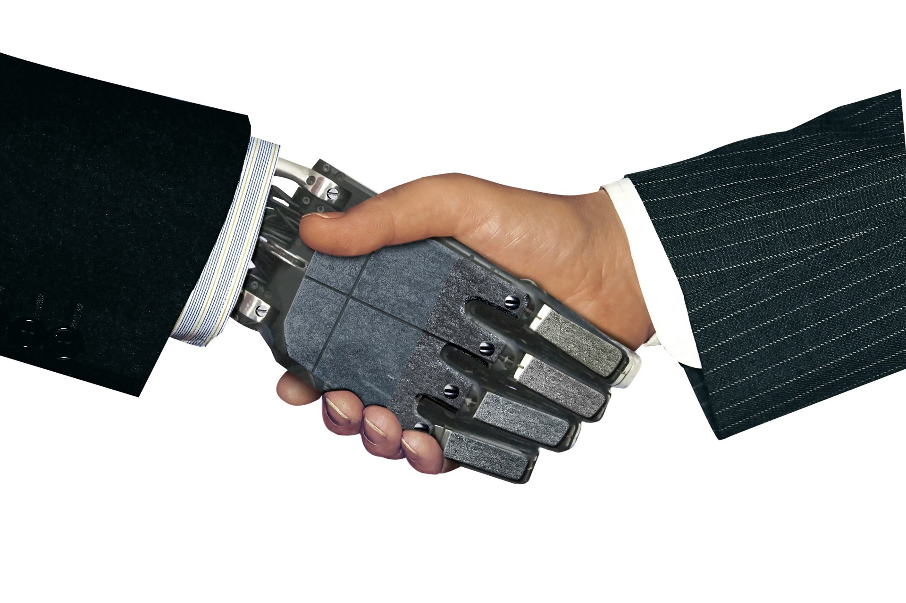

[THE ORANGE COUNTY CHAPTER OF THE PROJECT MANAGEMENT INSTITUTE presents...](https://www.pmi.org/)

### HUMAN AND MACHINE COLLABORATION

Using the skills you learned, decide which tasks will be performed by AI

Which onboarding techniques will you use to train your team?

What is your ongoing training plan?

What kind of AI will you choose?

How will you test your AI to make sure it performs as expected?

How will you evaluate performance and check milestones?

[Outline](01_outline.md)
